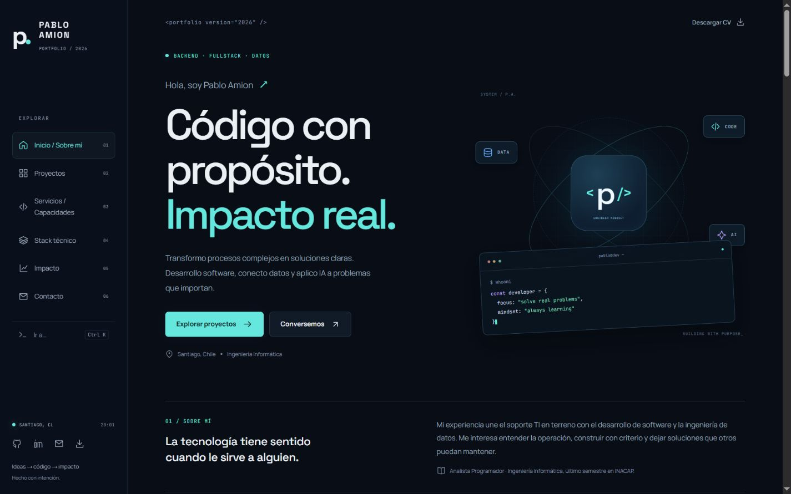

# Pablo Amion · Portafolio 2026

Portafolio personal con Astro y TypeScript, diseñado desde cero. Azul medianoche, tipografías locales, navegación lateral en escritorio y menú modal en móvil. Sin React en el cliente ni servicios externos para renderizar el contenido.

Publicado: **https://pabloamion-portfolio.pages.dev/**. Destino previsto: **https://pabloamion.is-a.dev**. Primera publicación verificada mediante Direct Upload; GitHub Actions preparado para futuras versiones. [Guía de publicación](deployment/README.md): la solicitud del dominio debe presentarla el propietario, según la política del registro.



La salida inicial contiene aproximadamente **1,9 KB de JavaScript comprimido**, tres fuentes WOFF2 locales y 13,9 KB de HTML comprimido. Son tamaños de archivos medidos durante la compilación, no una puntuación Lighthouse ni una promesa de tiempo de carga.

## Desarrollo

Requiere Node.js 24 LTS y npm. Node 22.18 del equipo es demasiado antiguo para esta versión de Astro. Usar Node 24, indicado en `.nvmrc` y `package.json`.

```sh
npm ci
npm run dev
```

## Verificación y producción

```sh
npm run check
npm run build
npm test
npm run preview
```

Salida publicable: `dist/`. Las pruebas de integración comprueban referencias, anclas, ARIA, SEO, archivos públicos y presupuesto de JavaScript. GitHub Actions ejecuta los mismos controles.

## Edición

- `src/data/portfolio.ts`: perfil, navegación, proyectos, capacidades y stack.
- `src/pages/index.astro`: página, SEO y diálogos de casos.
- `src/styles/`: diseño, figuras de proyectos y fuentes locales.
- `src/scripts/main.ts`: filtros, navegación activa, `Ctrl/Cmd + K`, copia de correo y guiños de Pokémon/slime.
- `public/PabloAmion_CV.pdf`: CV proporcionado por el propietario.
- `public/_headers`: cabeceras para Cloudflare Pages.
- `scripts/domain-record.mjs`: genera el registro a partir del hostname real de Pages.

Contenido basado en el CV y README públicos consultados el 21 de octubre de 2026. Se mantiene **último semestre de Ingeniería Informática**; no se atribuye un título ya obtenido. Los 48.000+ registros corresponden al CV de la implementación institucional. La demo pública usa datos sintéticos y su volumen puede diferir.

Se distinguen casos reales, demos y laboratorios. Las visuales de las cards son esquemas e interpretaciones, no capturas de los productos. No se exponen datos institucionales ni porcentajes de mejora sin evidencia. El resultado de ML se contextualiza en su test sintético.

Por decisión del propietario, Servicios describe capacidades sin precios ni venta directa para priorizar is-a.dev. El contacto es por correo y LinkedIn; no hay formulario que simule enviar sin backend.

## Accesibilidad y rendimiento

HTML semántico, salto al contenido, foco visible, diálogos nativos con Escape, estados accesibles, soporte de teclado, `prefers-reduced-motion`, WOFF2 locales y JavaScript mínimo.

No requiere `.env`. `SITE_URL` es una variable opcional de compilación para canonical, metadatos y sitemap. Nunca poner credenciales en el código.
